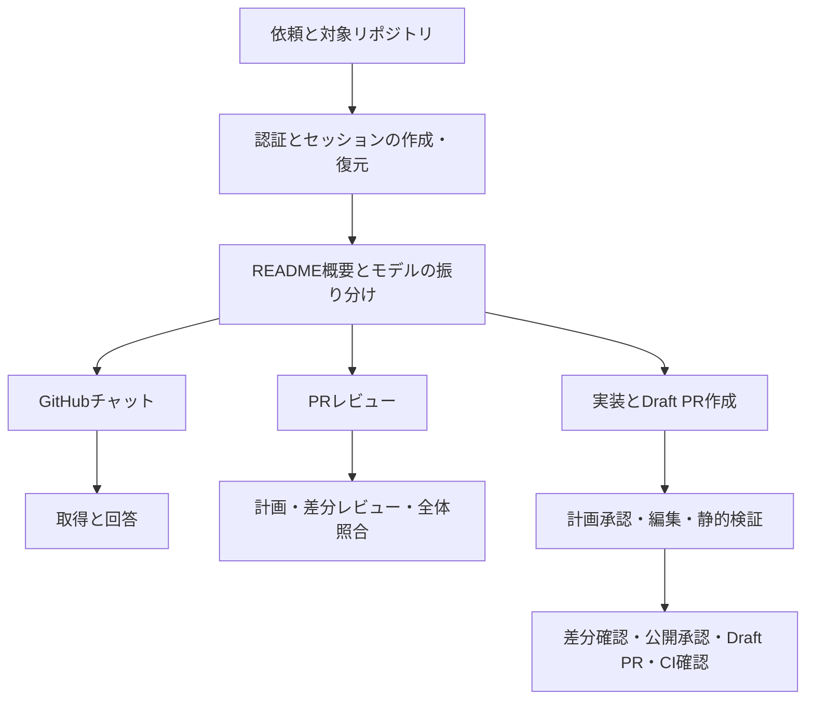
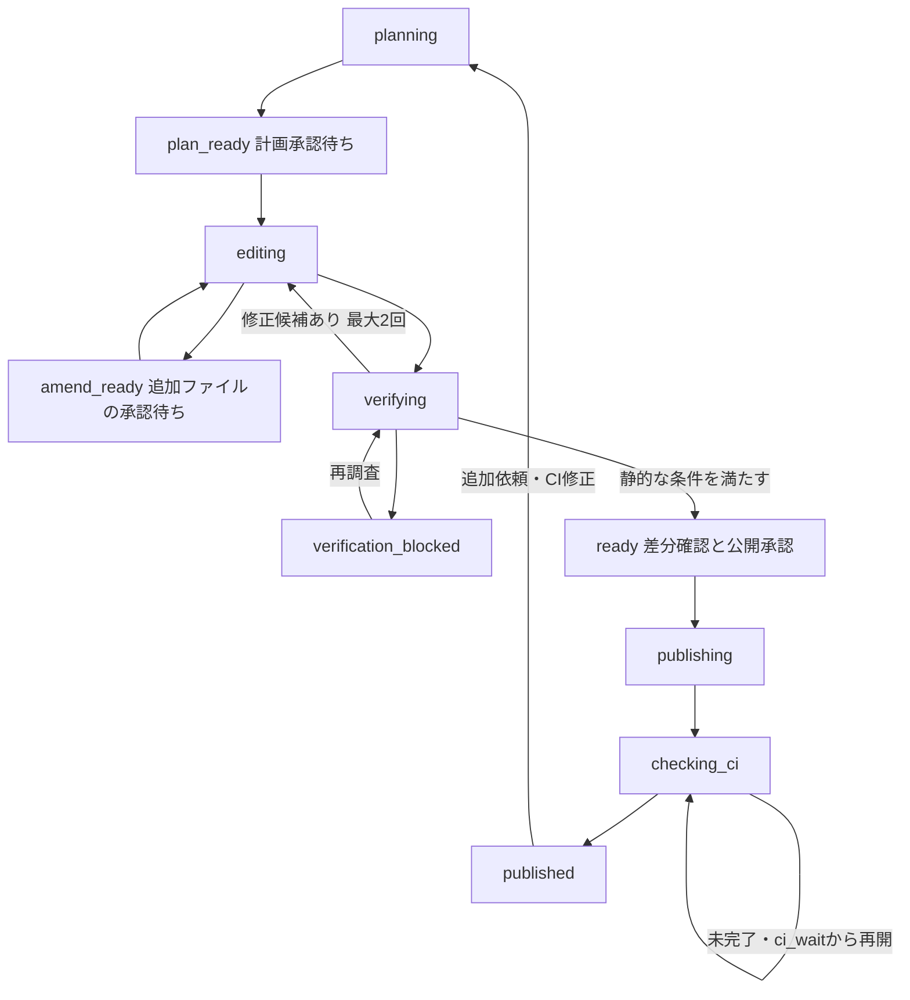

# AI Factoryのエージェントフロー

AI FactoryはGitHubの調査、PRレビュー、実装からDraft PR作成までをRunnerと保存可能な状態遷移で進める。AIは取得要求や変更案を返し、対象リポジトリ、コミット、操作の検証と保存・公開はサーバーが管理する。

## 全体構成

[Runner](../backend/internal/agent/runner.go) が段階ごとのプロンプトと構造化出力を切り替え、[ModelRouter](../backend/internal/agent/router.go) が選択したモデルをプロバイダーへ振り分ける。Firestoreは会話、計画、処理位置、検証結果、公開状況を保存する。コードと生成内容は期限付きキャッシュへ分けて保存する。

## 調査とレビュー

通常チャットは直近の会話、要点、追加指示から調査方針を決め、必要な情報を段階的に取得する。最後の判断は回答のために確保し、参照元と未確認範囲を保存する。

レビューはPRのbase/headを固定して計画を作り、関連する差分を分割して確認する。各バッチの要点を全体照合に使い、複数ファイルの指摘は元コードを追加取得して確認する。PRの更新を検出した場合は停止し、新しいレビューを案内する。

取得回数や入力の上限、未確認事項の扱いは[設計と制限](architecture.md)を参照する。

## 実装の状態遷移

計画と受け入れ条件を利用者が承認してから編集する。計画外のファイルは追加承認を待つ。静的検証では生成後コードと関連コードを読み、指摘・未確認・条件の未達が残れば公開を止める。変更不要のupdateを実効計画から外す場合も、検証と履歴の保存を必要とする。

公開承認後のGitHub書き込みはAIを呼ばず、専用アダプターが行う。完了した操作を保存し、再試行では残りだけを実行する。既存PRへの追加コミットは対象ブランチの先頭を確認し、他者の変更があれば止める。

`published` はCI成功を意味しない。対象コミットのCIを成功・失敗・待機・未確認に分けて保存する。CI待機中は接続したブラウザーが確認を継続し、停止操作と再接続にも対応する。

## 保存と再開

チェックポイントの保存完了後に次の段階へ進む。AI処理はWebSocket切断で中断し、利用者の再開操作を待つ。CI待機だけはAIキーを使わず自動継続する。

生成内容は24時間保持し、期限内なら利用者が延長できる。会話の30日の保存期限とは別に扱う。セッション累計トークン上限は再開時も引き継ぎ、到達後は次のAI呼び出し前に停止する。

状態と承認の実装は [websocket_conn.go](../backend/internal/httpapi/websocket_conn.go)、[implementation.go](../backend/internal/domain/implementation.go)、[implement.go](../backend/internal/agent/implement.go) を参照する。
