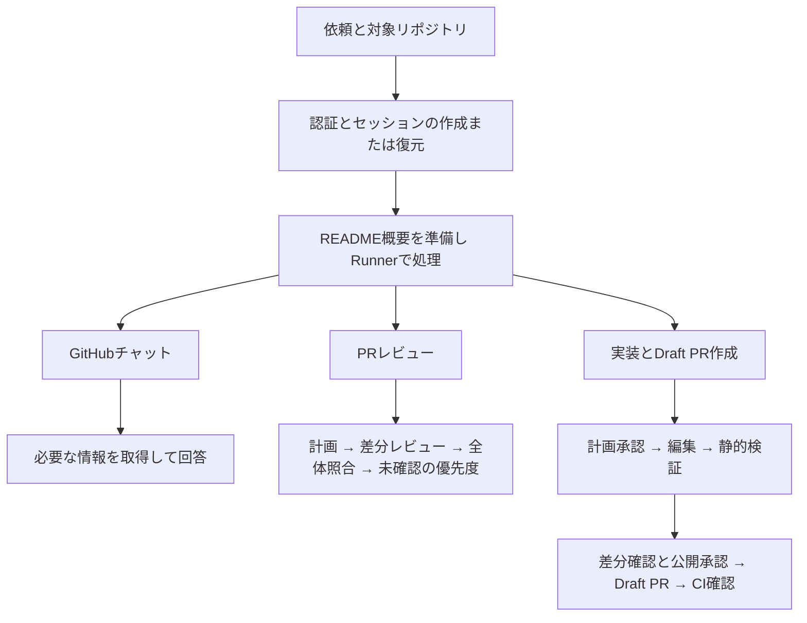
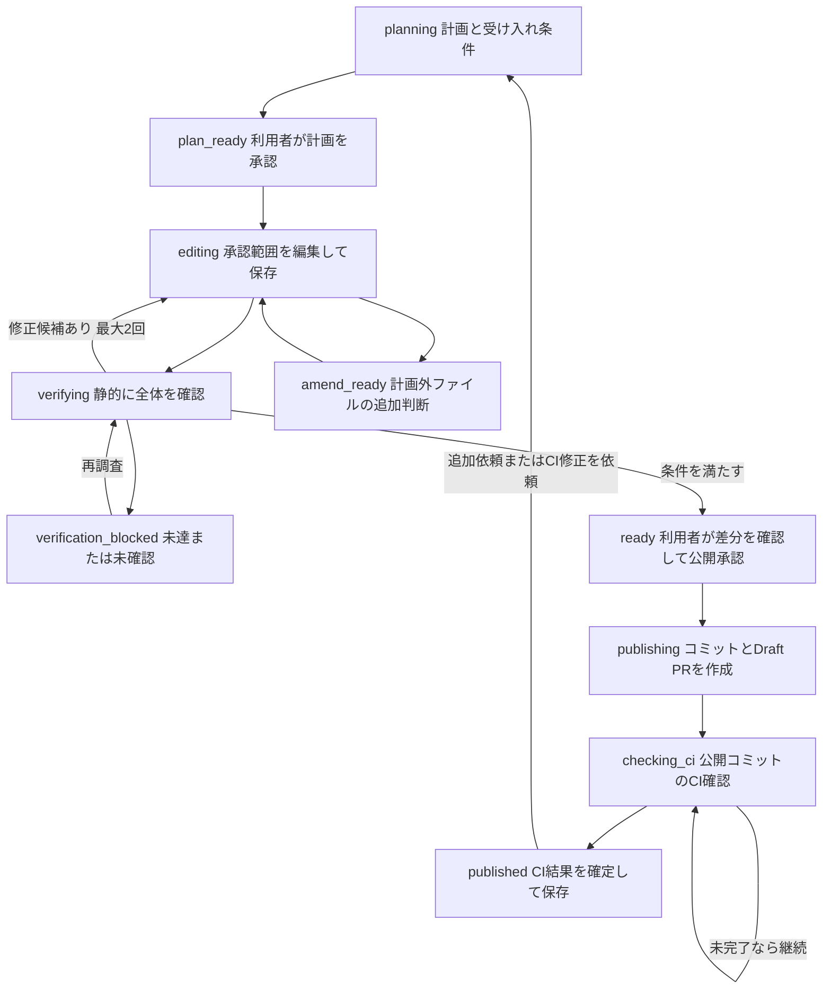

# AI Factory エージェントフローの現状と改善案

この文書はコミット`0a9d49d`時点のスナップショットです。その後の[改善の実装内容](agent-improvements.md)と、現在の[設計と制限](architecture.md)も参照してください。

## 現状の要約

AI Factoryは、GitHubの調査、PRレビュー、実装からDraft PR作成までを、GoのRunnerと保存可能な状態遷移で進める。実装では計画承認と公開前の差分確認を挟み、AIの提案をサーバーが検証してからGitHubへ反映する。

**基準日：2026年11月4日 日本時間。対象：origin/mainをpullしたコミット `0a9d49d`。** 以下の「できていること」は、このmainの実装と既存テスト定義に基づく。実サービスへの接続試験や本番稼働状況の確認は含めない。

計画、変更範囲の制御、静的検証、自動修正、追加依頼の引き継ぎ、公開後のCI確認まで実装されている。次の改善では、必須CIの網羅と実モデルの継続評価で成功判定を確かめ、公開前にも実行結果を修正へ返せるようにする価値が高い。**公開前の検証はAIによる静的確認であり、ビルドやテストの実行は公開後のGitHub CIが担う。**

[Runner](https://github.com/jeorp/ai-factory/blob/0a9d49dbc6a42766f608683ee24af0f65e503c0a/backend/internal/agent/runner.go)、[実装の状態制御](https://github.com/jeorp/ai-factory/blob/0a9d49dbc6a42766f608683ee24af0f65e503c0a/backend/internal/agent/implement.go)、[CI確認](https://github.com/jeorp/ai-factory/blob/0a9d49dbc6a42766f608683ee24af0f65e503c0a/backend/internal/agent/implement_ci_result.go)

## エージェントフロー

### 全体構成

Runnerがフェーズごとのプロンプトと構造化出力を切り替える。AIは読み取り要求、計画、編集案、検証結果を返し、対象リポジトリ・コミット・許可操作・保存・公開はサーバーが管理する。フェーズをまたいで、セッションで選択されたモデルを使う。

| 構成要素 | 役割 |
| --- | --- |
| VueとPinia | チャット、計画承認、差分確認、停止と再開、CIへのリンクを表示する |
| HTTP APIとWebSocket | 認証、接続lease、コマンド検証、進捗配信、チェックポイントの保存を担う |
| Runner | 調査、レビュー、計画、編集、静的検証、公開、CI確認を進める |
| ModelRouter | 設定されたモデルをOpenAI、Gemini、Claude API、Vertex AI経由のClaudeの各アダプターへ振り分ける。Geminiの対応モデルでは推論量も選べる |
| GitHubアダプター | 読み取り専用MCPとRESTで取得し、専用の書き込み処理でコミットとDraft PRを作成する |
| Firestoreと期限付きキャッシュ | 会話、計画、処理位置、検証結果、公開状況を保存し、コードや生成内容を別の一時領域に保持する |

[モデル振り分け](https://github.com/jeorp/ai-factory/blob/0a9d49dbc6a42766f608683ee24af0f65e503c0a/backend/internal/agent/router.go)、[プロバイダー設定](https://github.com/jeorp/ai-factory/blob/0a9d49dbc6a42766f608683ee24af0f65e503c0a/backend/internal/httpapi/config.go)、[推論量の設定](https://github.com/jeorp/ai-factory/blob/0a9d49dbc6a42766f608683ee24af0f65e503c0a/backend/internal/httpapi/effort.go)

### GitHubチャット

1. 新しいセッションの最初の実行で、固定コミットのREADMEから短いリポジトリ概要を準備する。取得や要約に失敗しても調査は続ける。

2. 最初のAI判断で質問の目的、調査方針、回答の深さと最初の取得要求をまとめる。

3. 許可されたファイル、ディレクトリ、PR、Issueなどを取得し、取得結果から次の調査か回答を選ぶ。同じ要求は実行内で再利用する。

4. 参照元、未確認範囲、要点、利用量を保存する。最後のAI判断は回答用に確保し、取得上限に達したら取得済みの範囲を説明する。

会話からPRレビューや実装の依頼と判断した場合は、対応する開始要求を検証し、同じセッションで専用フローへ移る。

[通常チャット](https://github.com/jeorp/ai-factory/blob/0a9d49dbc6a42766f608683ee24af0f65e503c0a/backend/internal/agent/runner.go)、[README概要](https://github.com/jeorp/ai-factory/blob/0a9d49dbc6a42766f608683ee24af0f65e503c0a/backend/internal/agent/overview.go)、[チャットの予算](https://github.com/jeorp/ai-factory/blob/0a9d49dbc6a42766f608683ee24af0f65e503c0a/backend/internal/agent/chat_budget.go)

### PRレビュー

1. 対象PRのbaseとheadのSHAを固定し、変更ファイルの目次とレビュー計画を作る。backendのみ、frontendのみの範囲指定も反映する。

2. 関連する実装とテストを最大10ファイルのバッチにまとめ、大きな差分は行番号を保って分割する。必要に応じて関連コードやコメントを追加取得する。

3. 各バッチの指摘と進捗を保存し、最後にファイル間の整合性を照合する。複数ファイルにまたがる指摘には、元コードの追加取得による裏付けを求める。

4. 未確認事項に優先度と理由を付け、指摘、根拠、未確認範囲を表示する。追加調査の結果も保存する。

PRが途中で更新された場合は中断し、新しいレビューを要求する。停止や予算到達後は保存位置から手動で再開する。レビュー結果のGitHub投稿は未実装。

[レビューの制御](https://github.com/jeorp/ai-factory/blob/0a9d49dbc6a42766f608683ee24af0f65e503c0a/backend/internal/agent/review.go)、[各レビュー段階](https://github.com/jeorp/ai-factory/blob/0a9d49dbc6a42766f608683ee24af0f65e503c0a/backend/internal/agent/review_phases.go)、[指摘の採用条件](https://github.com/jeorp/ai-factory/blob/0a9d49dbc6a42766f608683ee24af0f65e503c0a/backend/internal/agent/review_analyze.go)

### 実装からDraft PR作成

| 段階 | 処理と承認の条件 |
| --- | --- |
| 計画 | 新規実装では最新のデフォルトブランチのSHAを固定する。パス一覧、README、関連コードを使い、変更ファイル、依存順、受け入れ条件を作る。計画と条件を利用者が承認する |
| 編集 | 最大5ファイルの区切りで依存順に編集する。更新は検索置換、新規作成は全文を受け取り、サーバーがパス、操作、原文一致、サイズを検証する |
| 追加ファイル | 計画外の変更が必要なら理由付きで提示し、利用者の承認または見送りを待つ |
| 静的検証 | 変更後コードと関連コードを読み、受け入れ条件ごとの根拠を確認する。不具合に具体的な修正候補があれば承認範囲内で最大2回修正する。未達や静的な未確認が残れば公開を止める |
| 差分確認 | 利用者が差分、ブランチ名、タイトル、本文を確認して公開を承認する。ビルドやテストの予定は、静的な未確認事項と分けて保持する |
| 公開 | AIを呼ばず専用アダプターがコミット、ref、Draft PRを作る。途中まで完了した操作を保存し、再試行は残りから行う |
| CI確認 | 公開したSHAのチェックを10秒間隔で確認する。5分の待機で未完了なら待機状態に移り、接続中のクライアントが自動継続する。チェック0件が待機時間内に解消しなければ未確認にする |
| 追加修正 | 公開前は既存の生成内容を新しい版へ引き継ぐ。公開後はオープンで競合のない対象PRのAI Factoryブランチへ追加コミットする。CI修正では元の要求と受け入れ条件を保持して再計画し、再承認を受ける |

追跡中のPRがマージ・クローズ済みなら、新しいブランチで再計画する。修正先として明示指定した既存PRが閉じている場合は停止する。

変更不要と分かったupdateは編集担当が候補として提示できる。検証担当が元コードと受け入れ条件を確認した後に実効計画から外し、元の計画と理由を履歴に残す。全件が変更不要候補で実際の変更がない場合は、検証済みとせず空のPR作成を止める。

**`published`はCI成功だけを表す状態ではない。** CIには成功、失敗、待機、未確認の別状態があり、スキップ、一覧の省略、別SHAの結果を成功扱いにしない。

[計画](https://github.com/jeorp/ai-factory/blob/0a9d49dbc6a42766f608683ee24af0f65e503c0a/backend/internal/agent/implement_plan.go)、[編集](https://github.com/jeorp/ai-factory/blob/0a9d49dbc6a42766f608683ee24af0f65e503c0a/backend/internal/agent/implement_edit.go)、[検証](https://github.com/jeorp/ai-factory/blob/0a9d49dbc6a42766f608683ee24af0f65e503c0a/backend/internal/agent/implement_verify.go)、[計画の縮小](https://github.com/jeorp/ai-factory/blob/0a9d49dbc6a42766f608683ee24af0f65e503c0a/backend/internal/agent/implement_reconcile.go)、[CI待機](https://github.com/jeorp/ai-factory/blob/0a9d49dbc6a42766f608683ee24af0f65e503c0a/backend/internal/agent/implement_ci_result.go)

### 保存と主な上限

各チェックポイントは保存応答を待ってから次へ進む。会話や計画は30日の保存期限を持つ。生成コードはセッション本体から分離した1時間のキャッシュに保存し、期限切れなら古いベースへ戻さず停止する。接続が切れるとAI実行は中断し、再接続後に保存状態を復元する。通常のAI処理は手動再開、CI待機は条件を満たせば自動継続する。

| 処理 | 1実行の時間とAI呼び出し | 主な範囲 |
| --- | --- | --- |
| 通常チャット | 3分、最大7判断 | 取得最大6回、ファイル要求最大5件 |
| PRレビュー | 15分、最大100回 | 先頭200ファイルまで計画、1バッチ最大10ファイル、入力予算50万トークン、出力予算6.4万トークン |
| 実装 | 30分、最大100回 | 変更最大20ファイル、1ファイル100 KiB、生成内容合計200 KiB。計画の追加取得と検索は最大10回、検証は最大12回 |

レビューのトークン予算は次の呼び出し前に判定するため、最後の呼び出し分だけ超える場合がある。上限は1回の継続実行に対するもので、セッション全体の金額上限にはならない。

[保存と制限の設計](https://github.com/jeorp/ai-factory/blob/0a9d49dbc6a42766f608683ee24af0f65e503c0a/docs/architecture.md)、[レビュー予算](https://github.com/jeorp/ai-factory/blob/0a9d49dbc6a42766f608683ee24af0f65e503c0a/backend/internal/agent/review_budget.go)、[変更サイズの検証](https://github.com/jeorp/ai-factory/blob/0a9d49dbc6a42766f608683ee24af0f65e503c0a/backend/internal/domain/change.go)、[CI自動継続](https://github.com/jeorp/ai-factory/blob/0a9d49dbc6a42766f608683ee24af0f65e503c0a/frontend/web/src/stores/workspace.ts)

## できていること

### 調査とレビュー

- **根拠を取得して段階的に回答する。** 質問の意図、残り予算、直近の会話と要点、README概要を使って次の取得を決める。参照リンクと未確認範囲を残す。

- **大きなPRを分割して確認する。** SHA固定、範囲指定、差分の分割、バッチ保存、全体照合、未確認事項の優先付け、追加調査まで備える。

- **複数プロバイダーを同じ実行契約で扱う。** OpenAI、Gemini、Claude API、Vertex AI経由のClaudeのアダプターとモデル許可リストがある。Geminiの対応モデルでは推論量をセッションに保存して各呼び出しへ渡す。

[調査の実装](https://github.com/jeorp/ai-factory/blob/0a9d49dbc6a42766f608683ee24af0f65e503c0a/backend/internal/agent/runner.go)、[レビュー段階](https://github.com/jeorp/ai-factory/blob/0a9d49dbc6a42766f608683ee24af0f65e503c0a/backend/internal/agent/review_phases.go)、[接続設定](https://github.com/jeorp/ai-factory/blob/0a9d49dbc6a42766f608683ee24af0f65e503c0a/backend/internal/httpapi/config.go)

### 実装と静的検証

- **要求を受け入れ条件と変更計画へ変換する。** 根拠パス、確認方法、依存順を持ち、隣接テストや計画漏れ候補も見直してから承認を受ける。

- **現在の生成内容を使って追加編集する。** 変更済みコードを優先して取得・検索し、公開前の追加依頼でも生成内容と受け入れ条件を引き継ぐ。

- **不正な編集を保存前に拒否し、訂正情報を返す。** パスごとに操作を制約し、重複、計画外操作、検索不一致を検出する。必要ならハッシュ付きの行範囲方式へ切り替える。

- **生成コード全体と関連コードを静的に照合する。** 受け入れ条件をmet、unmet、unverifiedで記録し、取得していないコードに基づく達成判定を拒否する。Go、JavaScript/TypeScript、Pythonの検証観点を同梱する。

- **検証の指摘を修正へ戻す。** 最大2回の自動修正、追加ファイルの再承認、変更不要候補の独立確認がある。未確認事項の解除には、その項目に関係する新しい取得根拠を求める。

- **一時的なモデル障害から復旧する。** 実装の計画・編集・検証では通信障害、429、一部5xxを上限付きで再試行する。Geminiの時間切れでは編集区切りの分割を優先し、分割できない場合などは最大1回再試行する。

[編集構造の検証](https://github.com/jeorp/ai-factory/blob/0a9d49dbc6a42766f608683ee24af0f65e503c0a/backend/internal/agent/implement_changes.go)、[編集の復旧](https://github.com/jeorp/ai-factory/blob/0a9d49dbc6a42766f608683ee24af0f65e503c0a/backend/internal/agent/implement_edit_recovery.go)、[検証](https://github.com/jeorp/ai-factory/blob/0a9d49dbc6a42766f608683ee24af0f65e503c0a/backend/internal/agent/implement_verify.go)、[一時障害の再試行](https://github.com/jeorp/ai-factory/blob/0a9d49dbc6a42766f608683ee24af0f65e503c0a/backend/internal/agent/implement_retry.go)

### 公開と運用

- **承認範囲とGitHub書き込みを制御する。** 保護パス、シンボリックリンク、サブモジュール、認証情報らしい内容を拒否し、公開途中の再試行でも既存refやPRを照合する。

- **対象PRへ追加コミットできる。** 同一リポジトリの対象AI Factoryブランチを使い、公開直前のhead確認と強制更新をしないpushで他者の更新を保護する。

- **公開したコミットのCIを確認し、失敗から再計画する。** CI修正では全失敗ログと受け入れ条件を対応付ける。権限不足や根拠の省略があれば修正を止める。公開とCI再確認にはAIキーを使わない。

- **停止、復元、利用量の確認ができる。** leaseとユーザー分離、チェックポイント、取得量、トークン、経過時間、対応モデルの概算USD表示がある。通常ログはコード本文を避け、詳細ログはローカル限定で有効化する。

[GitHubへの書き込み](https://github.com/jeorp/ai-factory/blob/0a9d49dbc6a42766f608683ee24af0f65e503c0a/backend/internal/github/write.go)、[CI結果](https://github.com/jeorp/ai-factory/blob/0a9d49dbc6a42766f608683ee24af0f65e503c0a/backend/internal/agent/implement_ci_result.go)、[利用量パネル](https://github.com/jeorp/ai-factory/blob/0a9d49dbc6a42766f608683ee24af0f65e503c0a/frontend/web/src/components/SessionContextPanel.vue)、[詳細ログの制御](https://github.com/jeorp/ai-factory/blob/0a9d49dbc6a42766f608683ee24af0f65e503c0a/backend/internal/httpapi/config.go)

## 課題と改善案

P1は次の改善サイクルで優先する項目、P2は評価結果や利用規模に合わせて進める項目とする。

### P1 実モデルの継続評価を動かす

現行の回帰テストは状態制御や検証規則を確認する一方、実モデルの要求達成率までは示さない。評価基盤の要件書には4課題と独立採点が定義され、編集の信頼性に関する文書でも実モデルの再評価が残課題になっている。

本番と同じRunnerを呼ぶヘッドレス入口を用意し、固定課題、固定SHA、独立した採点テストで改善前後を比較する。初回CI成功率、要求達成率、誤った完了判定、編集復旧率、費用と時間を保存する。最初は既存の4課題を用い、未達や中断も集計対象にする。

[評価基盤の要件](https://github.com/jeorp/ai-factory/blob/0a9d49dbc6a42766f608683ee24af0f65e503c0a/docs/product/ai-factory-eval-requirements.md)、[編集の実モデル評価に残る作業](https://github.com/jeorp/ai-factory/blob/0a9d49dbc6a42766f608683ee24af0f65e503c0a/docs/implementation-edit-reliability.md)

### P1 必須CIを満たしたことまで判定する

現在は取得できたcheck runsの結果を確認し、20件を超える一覧は未確認にする。対象リポジトリで期待する必須ジョブの集合や、commit status経由の検査まで照合する仕組みはこの経路にない。

必須チェック名と発行元を設定し、一覧をページ取得して、すべてが対象SHAで成功した場合だけ「必要な検査が完了」と判定する。未登録、実行待ち、スキップ、別SHA、20件超、statusのみのCIを回帰ケースに含める。画面には不足している検査と未確認理由を表示する。

[チェック取得](https://github.com/jeorp/ai-factory/blob/0a9d49dbc6a42766f608683ee24af0f65e503c0a/backend/internal/github/checks.go)、[現在の成功判定](https://github.com/jeorp/ai-factory/blob/0a9d49dbc6a42766f608683ee24af0f65e503c0a/backend/internal/agent/implement_ci_result.go)

### P1 公開前の実行検証を追加する

静的検証では、型エラー、依存関係、実行時の挙動、既存機能の回帰を実行結果で確認できない。現在の実行結果はDraft PR公開後に得られる。

使い捨ての隔離環境で、合意したビルド、型検査、テストを実行し、失敗を編集と再検証へ返す。AIキーや書き込み用GitHubトークンは実行環境に渡さず、通信先、時間、CPU、メモリを制限する。コードのハッシュ、コマンド、終了状態、診断を記録し、未実行やタイムアウトを成功扱いにしない。まず対象言語とコマンドを限定した導入から始める。

[静的検証の範囲](https://github.com/jeorp/ai-factory/blob/0a9d49dbc6a42766f608683ee24af0f65e503c0a/backend/internal/agent/implement_verify.go)、[公開後のCI](https://github.com/jeorp/ai-factory/blob/0a9d49dbc6a42766f608683ee24af0f65e503c0a/backend/internal/agent/implement_ci_result.go)

### P2 生成内容の保存期間と再開を改善する

会話は30日残るが生成内容は1時間で期限切れになるため、長い承認待ちでは再開できなくなる。通常のAI処理もWebSocket接続に結び付いている。

承認待ちの生成内容をバージョンとハッシュ付きで保持する保存方式と、利用者が明示的に選べるバックグラウンド実行を検討する。保存期間、削除、鍵の扱いを先に決める。ページを閉じた後やサーバー再起動後でも、同じ版から再開でき、二重公開されないことを完了条件にする。

[生成内容のキャッシュ](https://github.com/jeorp/ai-factory/blob/0a9d49dbc6a42766f608683ee24af0f65e503c0a/backend/internal/github/change_cache.go)、[接続と実行の制御](https://github.com/jeorp/ai-factory/blob/0a9d49dbc6a42766f608683ee24af0f65e503c0a/backend/internal/httpapi/websocket_conn.go)

### P2 探索と編集の予算配分を改善する

文字列検索、ファイル目次、関連テストの見直しはあるが、取得・検索・編集の試行は固定枠を共有する。複雑な依存関係や長い原文の再現で、変更を確定する前に枠を使う可能性がある。

失敗トレースから取得と編集の消費を分けて測り、関連コードの発見、検索結果の重複排除、必要な文脈の保持を改善する。必要なら定義と参照の解析や、小さい行範囲で編集する方式を比較する。上限を一律に増やす前に、解決率、再試行数、入力トークンの変化で判断する。

[計画と探索](https://github.com/jeorp/ai-factory/blob/0a9d49dbc6a42766f608683ee24af0f65e503c0a/backend/internal/agent/implement_plan.go)、[編集の試行枠](https://github.com/jeorp/ai-factory/blob/0a9d49dbc6a42766f608683ee24af0f65e503c0a/backend/internal/agent/implement_edit.go)、[編集信頼性の分析](https://github.com/jeorp/ai-factory/blob/0a9d49dbc6a42766f608683ee24af0f65e503c0a/docs/implementation-edit-reliability.md)

### P2 金額予算と段階別の計測を加える

回数と時間の制限、トークン集計、概算USD表示はあるが、セッション全体の金額上限を保証するものではない。再開のたびに追加の実行予算を使える。

計画、編集、検証、再試行、CI待機ごとに時間とトークンを集計し、利用者が定めた概算予算に達したら次の呼び出し前に止める。料金未登録モデルやキャッシュ料金などの扱いを明示し、請求額とは分けて表示する。

[モデル呼び出しと利用量](https://github.com/jeorp/ai-factory/blob/0a9d49dbc6a42766f608683ee24af0f65e503c0a/backend/internal/agent/implement_model.go)、[概算料金の計算](https://github.com/jeorp/ai-factory/blob/0a9d49dbc6a42766f608683ee24af0f65e503c0a/frontend/web/src/lib/pricing.ts)

### P2 レビュー結果の反映までつなぐ

指摘と根拠は表示できるが、選択や編集、GitHubへのレビュー投稿は未実装。

指摘を選択して修正し、投稿直前にheadを再確認してからGitHubへ反映する。投稿済みの指摘を識別し、再試行で重複しないようにする。実装依頼へ引き継ぐ場合も、採用した指摘と受け入れ条件の対応を残す。

[現状の未実装項目](https://github.com/jeorp/ai-factory/blob/0a9d49dbc6a42766f608683ee24af0f65e503c0a/README.md)、[指摘の採用と根拠](https://github.com/jeorp/ai-factory/blob/0a9d49dbc6a42766f608683ee24af0f65e503c0a/backend/internal/agent/review_analyze.go)

### P2 検証担当の判定を独立した基準で評価する

編集と検証は役割を分けているが、同じセッションの選択モデルを利用する。AIが作った受け入れ条件だけでは、元の依頼から抜けた要求を検出しきれない可能性がある。

まず人が固定した要求と採点テストで検証結果を評価する。その上で、決定的な静的解析や別モデルでの追加検証を比較し、見逃しと誤検知、追加費用を測る。常時の多重呼び出しは、効果を確認してから採用する。

[モデルの共通振り分け](https://github.com/jeorp/ai-factory/blob/0a9d49dbc6a42766f608683ee24af0f65e503c0a/backend/internal/agent/router.go)、[受け入れ条件の確認](https://github.com/jeorp/ai-factory/blob/0a9d49dbc6a42766f608683ee24af0f65e503c0a/backend/internal/agent/implement_verify.go)、[独立採点の方針](https://github.com/jeorp/ai-factory/blob/0a9d49dbc6a42766f608683ee24af0f65e503c0a/docs/product/ai-factory-eval-requirements.md)

### P2 実装と既存ドキュメントの差をなくす

mainにはVertex AI経由のClaudeが実装されているが、READMEにはVertex AIが未対応と残っている。また設計文書は料金換算を未実装とする一方、UIには概算USD表示がある。

接続方式と実装済み機能の記述を更新し、重要な動作条件はコードや契約テストから参照できる形に寄せる。機能追加時にREADME、設計、UIの説明を同じ変更で確認する。

[READMEの制限事項](https://github.com/jeorp/ai-factory/blob/0a9d49dbc6a42766f608683ee24af0f65e503c0a/README.md)、[設計文書](https://github.com/jeorp/ai-factory/blob/0a9d49dbc6a42766f608683ee24af0f65e503c0a/docs/architecture.md)、[接続の実装](https://github.com/jeorp/ai-factory/blob/0a9d49dbc6a42766f608683ee24af0f65e503c0a/backend/cmd/api/main.go)、[概算表示](https://github.com/jeorp/ai-factory/blob/0a9d49dbc6a42766f608683ee24af0f65e503c0a/frontend/web/src/components/SessionContextPanel.vue)

## 優先順位と実施ステップ

1. **実モデル評価の入口と基準値を作る。** 既存4課題のうち1課題で接続を確認し、その後4課題を同じ条件で繰り返す。改善前の要求達成率、編集復旧率、時間、費用を記録する。

2. **必須CIの照合を実装する。** 正確なSHA、期待ジョブ、発行元、全件取得を結び付け、チェック欠落を検出する。評価基盤にも同じ判定を使う。

3. **公開前の隔離実行を限定導入する。** ビルドと短いテストから始め、失敗の診断を修正ループへ返す。導入前後を同じ課題で比較する。

4. **測定した失敗原因に応じてP2を進める。** 保存期限による離脱が多ければ再開、関連コードの不足が多ければ探索、再試行費用が大きければ予算配分を優先する。

| 評価指標 | 見る内容 |
| --- | --- |
| 要求達成率と誤った完了判定 | 元の依頼に対する独立採点と、アプリの公開可能判定が一致するか |
| 初回CI成功率と修正後の成功率 | 静的検証の効果とCI修正の効果を分けて見る |
| 編集復旧率 | 原文不一致、操作違反、一時障害から有効な編集へ戻れたか |
| 停止理由と再開結果 | 予算、権限、保存期限、未確認、利用者の停止を分ける |
| 所要時間と概算費用 | 成功した課題だけでなく失敗・中断を含む全試行で集計する |

計画承認、公開承認、保護パス、SHA固定、保存確認、未解決事項による公開停止は、改善後も維持する。

## 根拠となる実装

すべて[mainのコミット 0a9d49d](https://github.com/jeorp/ai-factory/tree/0a9d49dbc6a42766f608683ee24af0f65e503c0a)に固定した参照。コードの実装状況を優先し、既存文書の不一致は改善項目として記載した。

| 確認対象 | 主な参照 |
| --- | --- |
| 調査と振り分け | [runner.go](https://github.com/jeorp/ai-factory/blob/0a9d49dbc6a42766f608683ee24af0f65e503c0a/backend/internal/agent/runner.go)、[router.go](https://github.com/jeorp/ai-factory/blob/0a9d49dbc6a42766f608683ee24af0f65e503c0a/backend/internal/agent/router.go) |
| プロバイダーと推論量 | [config.go](https://github.com/jeorp/ai-factory/blob/0a9d49dbc6a42766f608683ee24af0f65e503c0a/backend/internal/httpapi/config.go)、[claude.go](https://github.com/jeorp/ai-factory/blob/0a9d49dbc6a42766f608683ee24af0f65e503c0a/backend/internal/agent/claude.go)、[effort.go](https://github.com/jeorp/ai-factory/blob/0a9d49dbc6a42766f608683ee24af0f65e503c0a/backend/internal/httpapi/effort.go) |
| レビュー | [review.go](https://github.com/jeorp/ai-factory/blob/0a9d49dbc6a42766f608683ee24af0f65e503c0a/backend/internal/agent/review.go)、[review_phases.go](https://github.com/jeorp/ai-factory/blob/0a9d49dbc6a42766f608683ee24af0f65e503c0a/backend/internal/agent/review_phases.go)、[review_analyze.go](https://github.com/jeorp/ai-factory/blob/0a9d49dbc6a42766f608683ee24af0f65e503c0a/backend/internal/agent/review_analyze.go) |
| 計画と編集 | [implement_plan.go](https://github.com/jeorp/ai-factory/blob/0a9d49dbc6a42766f608683ee24af0f65e503c0a/backend/internal/agent/implement_plan.go)、[implement_edit.go](https://github.com/jeorp/ai-factory/blob/0a9d49dbc6a42766f608683ee24af0f65e503c0a/backend/internal/agent/implement_edit.go)、[implement_changes.go](https://github.com/jeorp/ai-factory/blob/0a9d49dbc6a42766f608683ee24af0f65e503c0a/backend/internal/agent/implement_changes.go) |
| 検証と修復 | [implement_verify.go](https://github.com/jeorp/ai-factory/blob/0a9d49dbc6a42766f608683ee24af0f65e503c0a/backend/internal/agent/implement_verify.go)、[implement_repair.go](https://github.com/jeorp/ai-factory/blob/0a9d49dbc6a42766f608683ee24af0f65e503c0a/backend/internal/agent/implement_repair.go)、[検証ナレッジ](https://github.com/jeorp/ai-factory/blob/0a9d49dbc6a42766f608683ee24af0f65e503c0a/backend/internal/agent/verification_knowledge/README.md) |
| 計画縮小と障害復旧 | [implement_reconcile.go](https://github.com/jeorp/ai-factory/blob/0a9d49dbc6a42766f608683ee24af0f65e503c0a/backend/internal/agent/implement_reconcile.go)、[implement_retry.go](https://github.com/jeorp/ai-factory/blob/0a9d49dbc6a42766f608683ee24af0f65e503c0a/backend/internal/agent/implement_retry.go) |
| 追加依頼と保存 | [implement_revision.go](https://github.com/jeorp/ai-factory/blob/0a9d49dbc6a42766f608683ee24af0f65e503c0a/backend/internal/agent/implement_revision.go)、[change_cache.go](https://github.com/jeorp/ai-factory/blob/0a9d49dbc6a42766f608683ee24af0f65e503c0a/backend/internal/github/change_cache.go)、[firestore.go](https://github.com/jeorp/ai-factory/blob/0a9d49dbc6a42766f608683ee24af0f65e503c0a/backend/internal/store/firestore.go) |
| 公開とCI | [write.go](https://github.com/jeorp/ai-factory/blob/0a9d49dbc6a42766f608683ee24af0f65e503c0a/backend/internal/github/write.go)、[checks.go](https://github.com/jeorp/ai-factory/blob/0a9d49dbc6a42766f608683ee24af0f65e503c0a/backend/internal/github/checks.go)、[implement_ci_result.go](https://github.com/jeorp/ai-factory/blob/0a9d49dbc6a42766f608683ee24af0f65e503c0a/backend/internal/agent/implement_ci_result.go) |
| 画面とCI継続 | [ImplementationPanel.vue](https://github.com/jeorp/ai-factory/blob/0a9d49dbc6a42766f608683ee24af0f65e503c0a/frontend/web/src/components/ImplementationPanel.vue)、[implementationStatus.ts](https://github.com/jeorp/ai-factory/blob/0a9d49dbc6a42766f608683ee24af0f65e503c0a/frontend/web/src/lib/implementationStatus.ts)、[workspace.ts](https://github.com/jeorp/ai-factory/blob/0a9d49dbc6a42766f608683ee24af0f65e503c0a/frontend/web/src/stores/workspace.ts) |
| 回帰テストの例 | [実装品質](https://github.com/jeorp/ai-factory/blob/0a9d49dbc6a42766f608683ee24af0f65e503c0a/backend/internal/agent/implement_quality_test.go)、[計画縮小](https://github.com/jeorp/ai-factory/blob/0a9d49dbc6a42766f608683ee24af0f65e503c0a/backend/internal/agent/implement_reconcile_test.go)、[障害復旧](https://github.com/jeorp/ai-factory/blob/0a9d49dbc6a42766f608683ee24af0f65e503c0a/backend/internal/agent/implement_recovery_test.go)、[CI結果](https://github.com/jeorp/ai-factory/blob/0a9d49dbc6a42766f608683ee24af0f65e503c0a/backend/internal/agent/implement_ci_result_test.go) |
| 既存の設計と残課題 | [architecture.md](https://github.com/jeorp/ai-factory/blob/0a9d49dbc6a42766f608683ee24af0f65e503c0a/docs/architecture.md)、[編集信頼性](https://github.com/jeorp/ai-factory/blob/0a9d49dbc6a42766f608683ee24af0f65e503c0a/docs/implementation-edit-reliability.md)、[評価基盤要件](https://github.com/jeorp/ai-factory/blob/0a9d49dbc6a42766f608683ee24af0f65e503c0a/docs/product/ai-factory-eval-requirements.md) |
